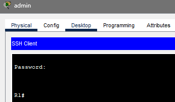
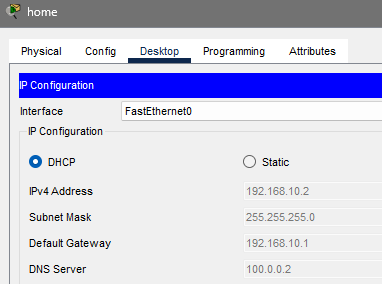
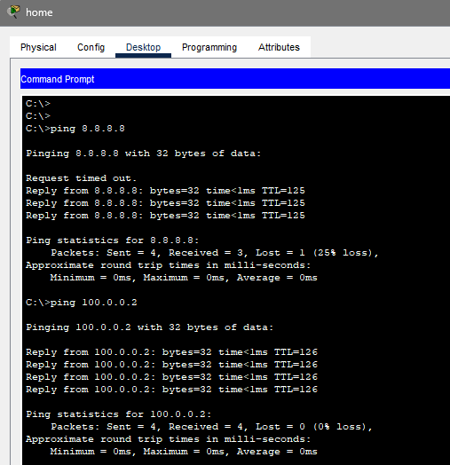
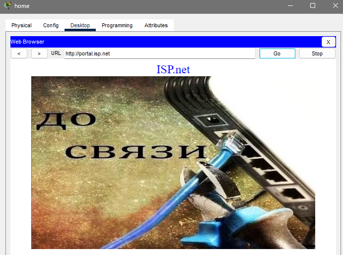

# Отчет по лабораторной работе 1.2
**Тема:** Настройка SSH, DHCP, NAT/PAT и списков контроля доступа (ACL)  
**Выполнил:** Пьянов Никита 439 группа  
**Специальность:** 09.02.06 «Сетевое и системное администрирование»  

---

## Топология


## Ответы на вопросы

1. **Вопрос 1.** Какой вариант подключения не сработал и почему?
   **Ответ:** Не сработал протокол **Telnet**. Соединение по SSH прошло успешно. Telnet не работает, потому что на виртуальных линиях (VTY) маршрутизатора R1 командой `transport input ssh` разрешены только входящие SSH-подключения, а незащищенные сессии Telnet заблокированы. Это обеспечивает безопасность управления устройством.
   

2. **Вопрос 2.** Какие IP-адрес R2 и маску сети получил?
   **Ответ:** R2 получил IP-адрес `192.168.20.2` с маской `255.255.255.252` (префикс /30) на интерфейсе Gi0/0. Также в таблице маршрутизации появился маршрут по умолчанию `S* 0.0.0.0/0` через next-hop `192.168.20.1` (адрес R1).
```text
R2# show ip interface Gi0/0
GigabitEthernet0/0 is up, line protocol is up (connected)
  Internet address is 192.168.20.2/30
...
R2# show ip route
...
Gateway of last resort is 192.168.20.1 to network 0.0.0.0
S*    0.0.0.0/0 [254/0] via 192.168.20.1
```

3. **Вопрос 3.** Какой IP-адрес получил ПК? Совпадают ли шлюз по умолчанию и DNS-сервер с указанными в DHCP-пуле?
   **Ответ:** ПК `home` получил IP-адрес `192.168.10.2`. Шлюз по умолчанию (`192.168.10.1`) и DNS-сервер (`100.0.0.2`) полностью совпадают с теми, что мы указали в настройках DHCP-пула на R2.
   

4. **Вопрос 4.** Приведите вывод команд проверки DHCP-сервера.
   *(Вставить текстовый вывод команд)*
```text
R2# show ip dhcp binding
Bindings from all pools not associated with VRF:
IP address       Client-ID/        Lease expiration     Type
                 Hardware address/
                 User name
192.168.10.2     0060.5C54.65AE     Oct 25 2026 12:00 PM  Automatic
```

5. **Вопрос 5.** Объясните результат проверки доступности 100.0.0.2 с ПК home.
   **Ответ:** Пинг не проходит (Request timed out). Пакет от ПК `home` (192.168.10.2) доходит до сервера (100.0.0.2). Сервер пытается отправить ответ на `192.168.10.2`. Пакет приходит на R1. R1 видит, что `192.168.10.0/24` — это напрямую подключенная сеть на интерфейсе Gi2/0, и отправляет ARP-запрос в сторону ПК `admin`. ПК `home` там нет, обратный маршрут потерян. Требуется NAT.

6. **Вопрос 6.** Повторите проверку доступности 100.0.0.2 с ПК home. Какой результат получен теперь?
   **Ответ:** Пинг прошел успешно (4/4 пакета). Трансляция NAT на R2 подменила адрес источника на IP-адрес интерфейса Gi0/0 (192.168.20.2), поэтому R1 знает, куда вернуть ответ.

7. **Вопрос 7.** Приведите вывод таблицы трансляций на R2 (`show ip nat translations`).
   *(Вставить текстовый вывод)*
```text
R2# show ip nat translations
Pro  Inside global      Inside local       Outside local      Outside global
icmp 192.168.20.2:5     192.168.10.2:5     100.0.0.2:5        100.0.0.2:5
icmp 192.168.20.2:6     192.168.10.2:6     100.0.0.2:6        100.0.0.2:6
```

8. **Вопрос 8.** Проверьте доступность узла 8.8.8.8 утилитой ping с ПК home. Объясните результат. Какие диапазоны IPv4-адресов относятся к приватным?
   **Ответ:** Пинг не проходит. Пакет от ПК home доходит до R2 (транслируется в 192.168.20.2) и уходит на R1. R1 отправляет его в Internet, но маршрутизатор Internet не знает, куда возвращать ответ, так как адрес `192.168.20.2` является приватным.
   К приватным (RFC 1918) относятся: `10.0.0.0/8`, `172.16.0.0/12`, `192.168.0.0/16`. Использовать их в глобальной сети без трансляции недопустимо.

9. **Вопрос 9.** Повторите проверку доступности 8.8.8.8 и 100.0.0.2. Приведите вывод таблицы трансляций на R1. Почему для пакетов к 100.0.0.2 трансляция не создается?
   **Ответ:** Пинги до 8.8.8.8 и 100.0.0.2 проходят успешно. В таблице трансляций R1 есть записи только для 8.8.8.8.
   Трансляция для 100.0.0.2 не создается, потому что адрес 100.0.0.2 принадлежит сети 100.0.0.0/30, подключенной к интерфейсу R1 Gi1/0, который не помечен как `ip nat outside`. Трансляция срабатывает только при выходе через внешний интерфейс Gi0/0.
   

10. **Вопрос 10.** Устанавливается ли соединение по SSH с ПК home? Как охарактеризовать ситуацию с точки зрения ИБ?
    **Ответ:** Соединение устанавливается. С точки зрения ИБ это уязвимость: любой узел сети может подобрать пароль к управлению маршрутизатором, так как нет ограничения по IP-адресам источника (ACL).

11. **Вопрос 11.** Опишите полученные результаты после применения ACL. Что изменилось?
    **Ответ:** С ПК home подключение по SSH блокируется, так как его адрес (192.168.20.2 после NAT) не входит в разрешенную сеть 192.168.10.0/24. С ПК admin подключение проходит успешно.

12. **Вопрос 12.** Приведите результат выполнения команды `show ip access-lists TO-SERVER`.
    *(Вставить текстовый вывод)*
```text
R1# show ip access-lists TO-SERVER
Extended IP access list TO-SERVER
    permit ip 192.168.10.0 0.0.0.255 100.0.0.0 0.0.0.3 (131 matches)
    permit udp any host 100.0.0.2 eq domain (2 matches)
    permit udp host 100.0.0.2 any eq domain
    permit tcp any host 100.0.0.2 eq www (113 matches)
    permit icmp 192.168.10.0 0.0.0.255 host 100.0.0.2
```

13. **Вопрос 13.** Какое правило созданного списка доступа блокирует эхо-запросы от ПК home?
    **Ответ:** Пакеты от ПК home приходят на R1 с адресом источника `192.168.20.2`. В ACL `TO-SERVER` разрешены ICMP-запросы только от сети `192.168.10.0/24`. Так как `192.168.20.2` не подпадает под это правило, пакет отбрасывается неявным запретом (`implicit deny`) в конце списка.

14. **Вопрос 14.** Какое из созданных правил является избыточным и почему?
    **Ответ:** Избыточными являются разрешающие правила для DNS, HTTP и ICMP от сети `192.168.10.0/24`. Первое правило `permit ip 192.168.10.0 0.0.0.255 100.0.0.0 0.0.0.3` разрешает любой IP-трафик, поэтому все последующие пакеты от admin к серверу совпадают именно с ним (счетчик matches = 131). Остальные правила для этой пары сетей не срабатывают.
    

15. **Вопрос 15.** Почему R1 успешно синхронизирует время, несмотря на отсутствие разрешающего правила для NTP?
    **Ответ:** Списки контроля доступа, примененные на интерфейсах, фильтруют только транзитный трафик. Трафик, который генерируется самим маршрутизатором (NTP-запросы), не проходит через механизм `ip access-group out` на его собственных интерфейсах.

---
## Вывод
В ходе работы были настроены механизмы безопасного удаленного доступа (SSHv2), динамической конфигурации узлов (DHCP-сервер и DHCP-ретранслятор), трансляции сетевых адресов с перегрузкой (PAT) на двух маршрутизаторах, а также расширенные и стандартные списки контроля доступа для фильтрации трафика и защиты управления.